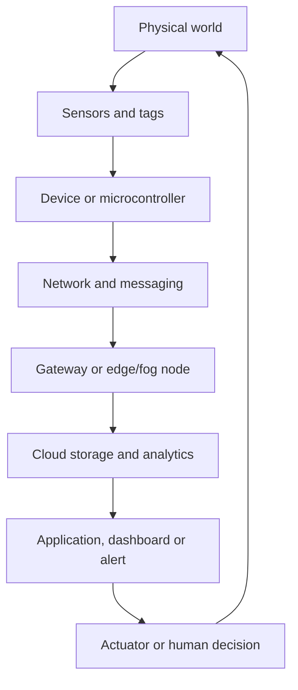

# MEGA README: NPTEL Introduction to IoT Assignments (Weeks 1-12)

A single revision guide for the 12 NPTEL *Introduction to Internet of Things* weekly assignments, built by reading the two assignment PDFs and the complete 254-page `allunits.pdf` course-note pack.

## What is included

- **Assignments:** Weeks 1-8 from `NPTEL-Assignment_Week1_8.pdf` (64 pages) and Weeks 9-12 from `Assignment_912.pdf` (29 pages). Each week contains 15 questions, for **180 questions total**.
- **Course notes:** `allunits.pdf` (254 pages), used as the primary concept source wherever its content overlaps the assignments.
- **For each week:** the main concepts, grounded examples, the relevant `allunits.pdf` page range, topic-by-topic reminders, and a question-by-question answer key with a short rationale based on the assignment's own solution.
- **Source-gap and mismatch register:** topics asked in the assignments that the notes omit or cover only briefly, plus a documented inconsistency where the two supplied sources disagree.

> **How to read this guide:** “Answer key” means the answer printed in the supplied assignment PDF. It is a study companion, not an independent audit of every lecture claim. Where the assignment and `allunits.pdf` differ, the README records the difference rather than silently choosing one version.

## Contents

- [Quick start and course map](#quick-start-and-course-map)
- [One-page concept map](#one-page-concept-map)
- [Week 1: IoT foundations, addressing, sensors and actuators](#week-1-iot-foundations-addressing-sensors-and-actuators)
- [Week 2: Messaging, low-power networking and RFID](#week-2-messaging-low-power-networking-and-rfid)
- [Week 3: Short-range, home and industrial communication](#week-3-short-range-home-and-industrial-communication)
- [Week 4: Wireless sensor networks, coverage and M2M](#week-4-wireless-sensor-networks-coverage-and-m2m)
- [Week 5: Interoperability, Arduino and physical I/O](#week-5-interoperability-arduino-and-physical-io)
- [Week 6: Python and Raspberry Pi basics](#week-6-python-and-raspberry-pi-basics)
- [Week 7: Remote data logging and software-defined networking](#week-7-remote-data-logging-and-software-defined-networking)
- [Week 8: SDN architectures and cloud computing](#week-8-sdn-architectures-and-cloud-computing)
- [Week 9: OpenStack, sensor-cloud and fog computing](#week-9-openstack-sensor-cloud-and-fog-computing)
- [Week 10: Smart cities, data fusion, HANs and connected vehicles](#week-10-smart-cities-data-fusion-hans-and-connected-vehicles)
- [Week 11: Smart grid, IIoT and Big Data](#week-11-smart-grid-iiot-and-big-data)
- [Week 12: Statistical analysis, AgriSens and IoT healthcare](#week-12-statistical-analysis-agrisens-and-iot-healthcare)
- [High-yield comparison tables](#high-yield-comparison-tables)
- [Allunits coverage map and source gaps](#allunits-coverage-map-and-source-gaps)
- [Final revision checklist](#final-revision-checklist)
- [Sources and scope notes](#sources-and-scope-notes)

## Quick start and course map

| `allunits.pdf` physical pages | Main subject in the notes | Assignment weeks that draw on it |
|---|---|---|
| 1-12 | IoT definitions, characteristics, architecture, challenges | 1, 9-12 (background concepts) |
| 13-53 | Sensors, sensor output, ADC, actuators, relays and selection | 1, 4-6, 12 |
| 54-108 | Arduino board, sketch structure, control flow, GPIO and interfacing | 5-6 |
| 109-146 | IPv4/IPv6 basics, MQTT, CoAP, XMPP, BLE, Li-Fi, network topologies and M2M | 1-5, 10-11 |
| 147-176 | IoT platforms, Python, Raspberry Pi, sensor integration and a server/dashboard pattern | 6-7, 9, 12 |
| 177-194 | Cloud computing and data analytics; sensor-cloud and fog material begins in this region | 8-9, 11-12 |
| 195-206 | SDN, interoperability, middleware and advanced IoT topics | 5, 7-9, 11 |
| 207-236 | Smart homes, cities, parking and connected vehicles | 4, 10-12 |
| 237-254 | Smart grid, IIoT and emerging IoT trends | 10-12 |

The Week 1-8 PDF places the Week 5 section before Week 4 in its page order. This README uses numerical week order so the study path remains sequential.

## One-page concept map



The four-layer architecture diagram on `allunits.pdf` page 8 places the perception layer at the physical end, followed by network, processing, and application layers. The notes also describe a five-layer version that adds a business layer. The exact number of layers depends on the architecture model being asked about, so name the model before answering.

A practical example: a soil-moisture sensor measures field conditions; a microcontroller reads the signal; a network carries readings to a gateway or server; analytics compare moisture with a threshold; the application reports the state; and a relay or valve activates irrigation. This one example connects sensing, addressing, messaging, cloud/edge processing, applications, and actuation.

---

## Week 1: IoT foundations, addressing, sensors and actuators

**Relevant notes:** `allunits.pdf` pp. 1-12 (IoT definitions and architecture), pp. 13-53 (sensors and actuators). The assignment adds several lecture-specific details that the notes do not spell out.

### Core concepts

**IoT is broader than machine-to-machine (M2M).** IoT connects physical objects that sense, communicate, process information and may trigger actions. M2M emphasizes automated exchanges between machines; IoT also includes gateways, cloud/platform services, applications and people. The Web of Things adds web-facing ways to discover and use IoT resources. It does not replace the physical sensors.

**Smart Dust** means very small sensing/computing devices intended to be distributed in an environment or introduced into a target area. The assignment uses soil chemistry and in-body sensing as examples.

**Addressing and gateways.** IPv4 uses 32-bit addresses and dotted-decimal notation; IPv6 uses 128-bit addresses and hexadecimal notation. Gateway-local address reuse conserves address space. The assignment also tests DHCPv6 prefix acquisition and SLAAC address autoconfiguration, but `allunits.pdf` does not explain these mechanisms in detail. Review them from the cited Week 1 lecture if you need a full protocol-level explanation.

**Sensor quality terms are not interchangeable.** Resolution is the smallest input change a sensor can distinguish. Accuracy concerns closeness to the true value. A sensor may offer fine resolution and still give biased readings. Hysteresis describes a different output for the same current input depending on whether the measured quantity approached that value from above or below. An accelerometer is a vector sensor when its readings represent acceleration components along x, y and z axes.

**Actuators turn a command into physical action.** The notes explain servos, solenoids, steppers and relays. Week 1 additionally tests hydraulic actuators and Shape Memory Polymer (SMP) actuators; those details are not developed in `allunits.pdf`.

### Worked examples

- **Sensor-to-cloud path from the assignment:** sensor -> gateway -> proxy server -> cloud server. The allunits architecture covers sensors, networks, gateways, processing and applications, but does not emphasize the proxy-server hop in this example.
- **ADC example from allunits p. 34:** the Arduino UNO example uses a 10-bit ADC over 0-5 V, yielding digital codes from 0 to 1023. The notes' 2.5 V input example gives an intermediate value of 511.5 and prints the approximation as about 511; follow that written course value when matching the notes, while recognizing the intermediate value lies between codes 511 and 512.
- **Smart irrigation:** sensor measures low soil moisture, controller evaluates the reading, relay drives a pump/valve, and the application logs or displays the result.

### Common traps

- IoT and M2M are related, not identical.
- Resolution is not accuracy; hysteresis is not quantization.
- Sensors measure; actuators act.
- IPv6 is 128-bit and hexadecimal, not dotted-decimal IPv4 notation.
- Do not infer a protocol's exact addressing behavior solely from the generic IoT architecture diagram.

### Source gap

The assignment's specific DHCPv6/SLAAC questions, hysteresis terminology, hydraulic actuator explanation and SMP stimulus/recovery properties are not all explained in the course notes. Use the assignment's own detailed solutions as the available source, and consult the named lectures for deeper coverage.


### Week 1 question-by-question answer key


The answer wording below follows the supplied assignment key; the final column condenses the explanation printed with that key.


| Q | What it tests | Answer printed in the assignment | Why / memory hook |
|---:|---|---|---|
| 1 | According to the ITU Internet Report 2005 discussed in the lecture, the future Internet is expected to become wider and more complex mainly because: | **b)** Most Internet traffic may flow between devices and different kinds of things | The ITU report describes a future where humans may become a minority as generators and receivers of traffic. Instead, communication will increasingly happen between devices and “things,” forming the Internet… |
| 2 | Which of the following are characteristics of IoT systems? | **a)** Efficient and scalable architecture; **b)** Unambiguous naming and addressing; **c)** Presence of sleeping nodes, mobile nodes, and non-IP devices | IoT systems require scalable architecture, clear naming and addressing, and must support heterogeneous devices such as sleeping nodes, mobile nodes, and non-IP devices. However, IoT systems may have… |
| 3 | In the lecture, “Smart Dust” refers to: | **c)** Very tiny computing devices that can be sprayed or injected for sensing purposes | Smart Dust refers to extremely small computing devices, smaller than a grain of sand, that can be used to measure chemicals in soil or diagnose problems in the human body. |
| 4 | Which statement best explains the relation between IoT and M2M communication? | **c)** M2M is a part of IoT, while IoT has a broader scope of interactions | M2M focuses mainly on communication among machines and devices. IoT is broader because it includes interactions between things, people, applications, and systems. |
| 5 | State whether the following statement is True or False. Statement: In the Web of Things, IoT sensors are replaced completely by cloud databases. | **b)** False | The Web of Things does not replace sensors. Sensors remain responsible for collecting physical-world data, while web technologies help expose and access IoT resources. |
| 6 | In an IoT network configuration, local addresses may be valid only within a gateway’s domain. The same local address may even appear under another… | **b)** It helps conserve address space | Using locally valid addresses within a gateway’s domain allows address reuse across different gateway domains. This helps avoid unnecessary wastage of global addresses. |
| 7 | Which of the following functions are associated with IoT gateways in the addressing strategy discussed in the lecture? | **a)** Providing Internet connectivity; **b)** Supporting IoT LAN intra-connectivity; **c)** Obtaining upstream address prefixes using mechanisms such as DHCPv6; **d)** Delegating addresses to nodes using SLAAC | IoT gateways can provide Internet connectivity and IoT LAN intra-connectivity. They may obtain upstream prefixes through DHCPv6 and delegate them to nodes using SLAAC. |
| 8 | Which of the following is true about IPv6 compared to IPv4? | **c)** IPv6 uses hexadecimal notation and supports a much larger address space | IPv4 uses 32-bit addresses and dotted decimal notation, whereas IPv6 uses 128- bit addresses and hexadecimal notation. This makes IPv6 more suitable for large-scale IoT addressing. |
| 9 | Which statement correctly represents the design expectation from a good sensor? | **c)** It should be sensitive to the measured property and should not disturb it | A good sensor should measure the desired property, remain insensitive to unrelated properties, and should not influence or alter the measured quantity. |
| 10 | Which of the following statements about sensor resolution are correct? | **a)** Sensor resolution is the smallest change that the sensor can detect; **b)** For a digital sensor, resolution is related to the smallest digital output change it can process; **d)** Sensor accuracy does not depend only on resolution | Resolution refers to the smallest detectable change in the measured quantity. In digital sensors, it is related to the smallest digital output step. However, accuracy and resolution are not the same; a… |
| 11 | State True or False. An accelerometer that measures acceleration along the x, y, and z coordinate axes is classified as a vector sensor. | **a)** True | A vector sensor measures quantities that have both magnitude and direction or orientation. Since an accelerometer measures acceleration components along different coordinate axes, such as x, y, and z, it is… |
| 12 | A sensor gives different output for the same input value depending on whether that input was reached by increasing or decreasing the measured… | **b)** Hysteresis error | Hysteresis error occurs when the sensor output depends on the previous input history. The same present input may give different readings depending on whether the input was approached from a lower or higher… |
| 13 | State True or False A hydraulic actuator can produce considerable force because liquids are nearly incompressible. | **b)** True | A hydraulic actuator uses hydraulic fluid to generate mechanical motion. Since liquids are nearly incompressible, hydraulic actuators can exert large forces. |
| 14 | Which of the following statements are correct about Shape Memory Polymer actuators? | **a)** They may respond to stimuli such as light, heat, electrical, magnetic, pH, or moisture changes; **b)** They can show high strain recovery; **c)** They may have properties such as low density and biocompatibility | Shape Memory Polymer actuators can respond to different stimuli and are known for features such as low density, high strain recovery, biocompatibility, and biodegradability. They are actuator materials, not… |
| 15 | State whether the following statement is True or False. Statement: According to the IoT implementation example discussed in the lecture, data… | **a)** True | In the example IoT implementation, the sensor first collects the data. The data then passes through the gateway and proxy server before reaching the cloud server for further processing and analytics. |


---


## Week 2: Messaging, low-power networking and RFID

**Relevant notes:** `allunits.pdf` pp. 109-146, especially pp. 112-123 for messaging, pp. 124-131 for BLE/Li-Fi, and pp. 137-146 for network and M2M summaries. The question set also tests IEEE 802.15.4/ZigBee/6LoWPAN details that receive only limited coverage in the notes.

### MQTT: publish-subscribe

A publisher sends a message to a **topic**. A broker uses that topic to route the message to matching subscribers. A publisher does not need to know the subscribers individually.

- `home/+/temperature`: `+` matches exactly one topic level, such as `home/kitchen/temperature`.
- `home/#`: `#` matches descendant topic levels under `home`.
- QoS 0 is at-most-once, QoS 1 is at-least-once and may duplicate, and QoS 2 is exactly-once in the notes' comparison.
- The assignment gives Secure MQTT (SMQTT) stages as setup, encryption, publish and decryption. Route discovery is not a stage in that list.

### CoAP: request-response for constrained devices

The notes describe CoAP as lightweight, REST-oriented and designed for constrained devices. The course notes place it over UDP, commonly on port 5683, and contrast it with HTTP over TCP. They cover confirmable and non-confirmable messages, acknowledgments, reset messages, resource observation, block transfer, multicast and discovery. In piggyback mode, a response travels with the acknowledgment; in separate mode, the server acknowledges first and sends its response later.

**Important source mismatch:** Week 2 Q6's printed answer says all four listed mappings are correct, including “PUT - create data” and “PUSH - update data.” However, `allunits.pdf` p. 117 lists GET/retrieve, POST/create, PUT/update and DELETE/delete. Keep this mismatch visible when revising rather than memorizing both sets as if they agreed. The answer table below reports the assignment's key and the source-gap register documents the notes' version.

### AMQP and lower-layer networking

AMQP uses an **exchange** to receive and route messages, **queues** to retain messages for consumers, and **bindings** to specify routing relationships. The assignment asks which frame controls message-flow rate: **Flow**. Transfer carries messages; Disposition communicates transfer state; Detach closes a link.

IEEE 802.15.4 supplies low-power physical/MAC capabilities; ZigBee builds higher-layer network/application functionality on top. For a non-beacon-enabled IEEE 802.15.4 network, the assignment specifies unslotted CSMA/CA. In 6LoWPAN, the assignment distinguishes a 16-bit PAN-specific short address from a 64-bit extended address. Passive RFID tags harvest power from the reader field, so they do not depend on an internal battery for the reply in the described interaction.

### Mini examples

```text
Publisher: city/parking/lot3/available = 12
Subscriber: city/parking/+/available
Broker: forwards the update to subscribers whose filters match
```

```text
Exchange -> (binding/routing rule) -> Queue -> Consumer
```

### Common traps

- MQTT routes using topics; AMQP exchange/queue/binding roles are distinct.
- MQTT `+` is single-level; `#` is multi-level.
- CoAP uses UDP in the supplied notes; MQTT is shown over TCP.
- IEEE 802.15.4 and ZigBee are related layers, not synonyms.
- A passive RFID tag receives energy from the reader interaction.


### Week 2 question-by-question answer key


The answer wording below follows the supplied assignment key; the final column condenses the explanation printed with that key.


| Q | What it tests | Answer printed in the assignment | Why / memory hook |
|---:|---|---|---|
| 1 | In MQTT, which field of a published message is used by the broker as routing information? | **a)** Topic | The MQTT broker dispatches messages between senders and receivers. The topic included in a published message provides the routing information that the broker uses to deliver the message to clients subscribed… |
| 2 | Which of the following statements about MQTT topic wildcards are correct? | **a)** The plus sign (+) matches an arbitrary value at exactly one hierarchy level.; **b)** The hash sign (#) can be used to subscribe to all underlying hierarchy levels.; **d)** The subscription house/+/temperature can match… | The plus sign (+) is a single-level wildcard, whereas the hash sign (#) is a multilevel wildcard. Thus, house/+/temperature can match house/kitchen/temperature, and house/# matches all topics whose hierarchy… |
| 3 | Which of the following are main stages of Secure MQTT (SMQTT)? | **a)** Setup; **b)** Publish; **c)** Decryption | SMQTT consists of four main stages: setup, encryption, publish, and decryption. Route discovery is not one of the SMQTT stages. |
| 4 | At the transport layer, CoAP (Constrained Application Protocol) operates over which protocol? | **b)** UDP | CoAP is designed for constrained environments and operates over UDP at the transport layer. Its lightweight design helps reduce communication overhead for resource-constrained IoT devices. |
| 5 | State True or False. In CoAP, a piggyback response is carried with the acknowledgment, whereas in the separate mode, the server response is sent in… | **a)** True | In the piggyback mode, the server places its response in the acknowledgment message. In the separate mode, the acknowledgment is sent first and the response is transmitted later as a separate message. |
| 6 | Which of the following CoAP request-method mappings are correct? | **a)** GET - retrieve data; **b)** PUT - create data; **c)** PUSH - update data; **d)** DELETE - delete data | As presented in the lecture, CoAP uses GET, PUT, PUSH, and DELETE requests to retrieve, create, update, and delete data, respectively. |
| 7 | Which AMQP frame type is used to control the message-flow rate? | **d)** Flow | The Flow frame controls the rate of message flow between AMQP peers. By comparison, Transfer carries messages, Disposition communicates a change in transfer state, and Detach terminates a link. |
| 8 | Which of the following statements about AMQP components are correct? | **a)** An exchange receives messages and routes them to queues.; **b)** A queue stores messages for business processes or consumers.; **c)** A binding specifies message-distribution rules between an exchange and queues. | The main AMQP components discussed in the lecture are exchanges, queues, and bindings. An exchange receives and routes messages, a queue stores messages for consumers or business processes, and a binding… |
| 9 | Which of the following IEEE 802.15.4 variant-application pairs are correct? | **a)** IEEE 802.15.4c - China; **b)** IEEE 802.15.4e - Industrial applications; **c)** IEEE 802.15.4f - Active RFID; **d)** IEEE 802.15.4g - Smart utility networks | The lecture associates IEEE 802.15.4c with China, 802.15.4d with Japan, 802.15.4e with industrial applications, 802.15.4f with active RFID, and 802.15.4g with smart utility networks. |
| 10 | In a non-beacon-enabled IEEE 802.15.4 network, data frames are transmitted using: | **b)** Unslotted CSMA/CA | Non-beacon-enabled IEEE 802.15.4 networks transmit data frames using unslotted CSMA/CA. In contrast, beacon-enabled networks use slotted CSMA/CA with a superframe structure managed by the PAN coordinator. |
| 11 | Which statement correctly describes the relationship between IEEE 802.15.4 and ZigBee? | **a)** IEEE 802.15.4 provides layers 1 and 2, while ZigBee extends the functionality to layer 3 and above. | IEEE 802.15.4 primarily specifies the physical and MAC layers. ZigBee operates on top of these layers and adds higher-layer functions, including authentication, encryption, routing, forwarding, and support… |
| 12 | Which of the following statements characterizes a ZigBee end device? | **a)** It communicates with its parent node.; **b)** It cannot relay data for other devices.; **c)** It is a reduced-functionality device. | A ZigBee end device has sufficient functionality to communicate with its parent, but it cannot relay data for other devices. It is therefore a reduced-functionality device. The coordinator, not an end device,… |
| 13 | Which option correctly describes addressing in 6LoWPAN? | **b)** A 16-bit short address is PAN-specific and assigned by the PAN coordinator, while a 64-bit extended address is globally unique. | 6LoWPAN supports 16-bit short addresses for PAN-specific communication; these are assigned by the PAN coordinator. It also supports 64-bit extended addresses, which are globally unique. |
| 14 | State True or False. In LOADng routing, an intermediate router may respond to a Route Request (RREQ) whenever it already has an active route to the… | **b)** False | In LOADng, only the destination is permitted to respond to an RREQ. Intermediate LOADng routers are explicitly prohibited from responding, even when they have an active route to the requested destination. |
| 15 | How does a passive RFID tag obtain the power required to transmit information? | **b)** It is powered inductively by an RFID reader. | Passive RFID tags do not have their own power supply. They must first be powered inductively by an RFID reader before they can transmit information. Active RFID tags, in contrast, have their own power supply. |


---


## Week 3: Short-range, home and industrial communication

**Relevant notes:** `allunits.pdf` pp. 124-146 and the short-range/network technology summaries around pp. 137-145. Coverage is partial: Wired HART, NFC's magnetic-induction explanation, the particular Z-Wave frequencies, Bluetooth Link Manager Protocol, channel-exclusion wording and the assignment's “dumb behavior” term are mostly lecture-specific.

### Communication choices

- **Bluetooth/BLE:** Bluetooth supports short-range personal-area communication. The notes' BLE section emphasizes ultra-low power, advertising, central/peripheral roles, GAP for discovery/connection behavior, and GATT for organizing data exchange. The assignment identifies Bluetooth with ad-hoc networking and says the Link Manager Protocol handles link establishment, authentication and configuration.
- **ZigBee:** The notes place ZigBee in short-range mesh applications and link it to IEEE 802.15.4. The assignment asks for a common data rate of 250 kbps.
- **Z-Wave:** The assignment's frequency pair is 908.42 MHz in the US and 868.42 MHz in Europe. It calls the procedure for bypassing radio dead spots **healing**. These exact frequencies and phrasing do not appear in `allunits.pdf`.
- **NFC:** Near Field Communication; the assignment says it works through magnetic induction and highlights the reader generating the field. Ordinary supermarket product tags are not examples of active NFC in the question's framing.
- **Wired HART:** The assignment says Wired HART has no network layer. `allunits.pdf` does not provide a detailed Wired HART protocol breakdown.

### Resource constraints

Sensor nodes do not have unlimited battery life. Power use affects reporting frequency, communication range, duty cycling and maintenance. A sleepy sensor may save energy but may not be continuously reachable. That is why a network's design needs to balance reporting frequency and reliability rather than assuming every node remains online permanently.

### Common traps and gaps

- Do not mix up the assignment's Z-Wave frequency pair with 2.4 GHz technologies such as ZigBee and BLE.
- “Active” and “passive” refer to tag/device behavior and powering, not whether the object is digitally connected in a general sense.
- The Week 3 Q4 answer is **“None of these”** for the channel-interference process. The notes do not name the exact term tested there, so do not invent a synonym based on guesswork.
- The term “dumb behavior” in Q3 is described by the assignment as temporal because it depends on environmental conditions; `allunits.pdf` does not expand that taxonomy.


### Week 3 question-by-question answer key


The answer wording below follows the supplied assignment key; the final column condenses the explanation printed with that key.


| Q | What it tests | Answer printed in the assignment | Why / memory hook |
|---:|---|---|---|
| 1 | State whether the following statement is true or false. Statement: There is no network layer in Wired HART | **a)** True | There is no network layer in Wired HART. |
| 2 | Zwave operates at ________ MHz in the US and ________ MHz in Europe. | **b)** 908.42, 868.42 | Zwave operates at 908.42 MHz in the US and 868.42 MHz in Europe. |
| 3 | Dumb behavior of sensor nodes is _______________ in nature (as it is dependent on the effects of the environmental conditions). | **a)** Temporal | Dumb behavior of sensor nodes is Temporal in nature (as it is dependent on the effects of the environmental conditions). |
| 4 | The process of identifying channels consistently affected by interference and removing them from use is known as _________________. | **d)** None of these | Channel Blacklisting identifies channels consistently affected by interference and removes them from use. |
| 5 | The full form of NFC is | **b)** Near Field Communication | The full form of NFC is Near Field Communication. |
| 6 | State true or false. NFC works on the principle of magnetic induction. | **a)** True | NFC works on the principle of magnetic induction. |
| 7 | State whether the following statement is true or false. Statement: NFC tags found in supermarket products are examples of active NFC. | **b)** False | Passive NFC tags found in supermarket products are examples of passive NFC. |
| 8 | Bluetooth is based on ___________. | **d)** None of these | Bluetooth is based on Piconets. |
| 9 | A __________ in NFC emits a small electric current which creates a magnetic field that in turn bridges the physical space between the devices. | **a)** reader | A reader in NFC emits a small electric current which creates a magnetic field that in turn bridges the physical space between the devices |
| 10 | State true of false. Bluetooth technology is based on Ad-hoc network technology. | **b)** True | Bluetooth technology is based on Ad-hoc network technology. |
| 11 | State true or false. Zwave utilizes GFSK modulation and Hongkong channel encoding. | **b)** False | Zwave utilizes GFSK modulation and Manchester channel encoding. |
| 12 | The process of bypassing radio dead-spots is done using a message called ________ in Zwave. | **b)** Healing | The process of bypassing radio dead-spots is done using a message called Healing in Zwave. |
| 13 | State whether the following statement is true or false. Statement: Sensor nodes have unlimited battery life. | **b)** False | Sensors nodes have limited battery life. |
| 14 | State whether the following statement is true or false. Statement: The Link Manager Protocol in Bluetooth manages the establishment, authentication,… | **a)** True | The Link Manager Protocol in Bluetooth manages the establishment, authentication, link configuration. See Page number – 157, Chapter - 7, Book - Introduction to IoT, Authors – Sudip Misra, Anandarup… |
| 15 | Zigbee commonly uses __________data rate. | **a)** 250 kbps | Zigbee commonly uses 250 kbps data rate. See Page number – 131, Chapter - 7, Book - Introduction to IoT, Authors – Sudip Misra, Anandarup Mukherjee, and Arijit Roy, Publisher – Cambridge University Press,… |


---


## Week 4: Wireless sensor networks, coverage and M2M

**Relevant notes:** `allunits.pdf` pp. 13-53 for sensors and the ultrasonic distance sensor, pp. 132-146 for network topology and M2M. The source notes give general topology and sensor material, but much of the static-WSN/UAV coverage terminology is present primarily in the assignment solutions.

### Agricultural Intrusion Detection (AID)

In the assignment's AID example, the ultrasonic sensor measures the distance to an object and a microcontroller processes sensor readings. This is a familiar edge-control pattern: sensing occurs at the sensor, control logic runs on the microcontroller and an alert or action can follow.

The notes' ultrasonic example (p. 27) uses echo travel time and the speed of sound to estimate object distance. The signal travels to the object and back, so the one-way distance calculation divides the round-trip distance by two. For the notes' example, a 2,000 microsecond echo pulse gives 34.3 cm.

### Coverage, reporting and connectivity

The assignment states that sensing coverage guarantees network connectivity when the **transmission range is at least twice the sensing range**. Example: if the sensing range is 10 m, the stated condition requires a transmission range of at least 20 m. Treat that as the assignment's specified condition.

- **Area coverage** asks whether the target area receives sensing coverage.
- **Event-driven reporting** sends a report when an event such as a forest-fire condition occurs.
- **On-demand reporting** sends data in response to an explicit request.
- **Data mule** means a mobile carrier collects data from isolated sensor nodes and physically carries it to a sink/base station.
- A critical fixed sensor failure can partition a network if it removes a necessary connectivity path. Fixed networks are easier to plan and maintain topologically, but fixed nodes cannot move to self-repair a broken path.
- UAV networks change topology frequently because aircraft move.

### M2M compared with traditional SCADA

M2M enables direct automated device exchanges and cross-platform integration. In the assignment's comparison, it supports integration across systems rather than only isolated, human-mediated equipment. The notes' M2M comparison on pp. 142-145 reinforces the difference between a limited device-to-device link and a wider IoT ecosystem.

### Common traps

- Sensing coverage and communication connectivity are different requirements.
- A data mule transports collected data; it does not replace all sensors.
- A stationary WSN should not be assumed to reposition a node automatically after failure.
- Mobility makes topology changes more likely, which is why UAV network design differs from static deployment.


### Week 4 question-by-question answer key


The answer wording below follows the supplied assignment key; the final column condenses the explanation printed with that key.


| Q | What it tests | Answer printed in the assignment | Why / memory hook |
|---:|---|---|---|
| 1 | What does the ultrasonic sensor measure generally in the AID system? | **b)** Distance of the object | In the Agricultural Intrusion Detection system, the ultrasonic sensor measures the distance at which the detected object is located. |
| 2 | Which component processes the data received from the sensors in the AID system? | **c)** Microcontroller | The microcontroller processes the data received from the sensors in the AID system. |
| 3 | How can standard nanodevices communicate? | **a)** Electromagnetic communication; **b)** Molecular communication | The lecture discusses electromagnetic and molecular communication for nanodevices. |
| 4 | When does sensing coverage guarantee network connectivity? | **a)** When the transmission range is at least twice the sensing range | Sensing coverage guarantees connectivity when the transmission range is at least twice the sensing range. |
| 5 | Which of the following is a coverage problem in a static WSN? | **a)** Area coverage | Area coverage is a standard coverage problem in a static wireless sensor network. The other options are networking tasks, not coverage categories. |
| 6 | Which reporting method is used for forest-fire monitoring in a WSN? | **a)** Event-driven reporting | Forest-fire monitoring uses event-driven reporting because sensor nodes report data when a fire-related event is detected. The lecture contrasts this with on-demand reporting, such as an inventory- control… |
| 7 | What does a data mule do? | **c)** Collects data and carries it to the sink | A data mule visits sensor nodes, collects their data, and delivers it to the sink. |
| 8 | What may happen if a critical stationary sensor node fails? | **a)** The network may be partitioned | Failure of a critical stationary node may divide the network into disconnected parts. |
| 9 | A person who provides sensing information acts as a: | **d)** Data source | In human-centric sensing, a person may act as a data source by providing or collecting information. |
| 10 | Which is an advantage of a stationary wireless sensor network? | **a)** Easy topology maintenance | In a stationary wireless sensor network, sensor nodes remain fixed. Therefore, deployment and topology maintenance are comparatively easier. |
| 11 | State whether the following statement is True or False. Statement: In a UAV network, the network topology may change frequently because the UAVs are… | **a)** True | UAVs move from one location to another, causing frequent changes in their relative positions and communication links. Therefore, the network topology may change frequently. |
| 12 | Which is a common issue in UAV networks? | **a)** Frequent topology changes | UAV movement causes frequent changes in network topology and communication links. |
| 13 | Compared with traditional SCADA, M2M supports: | **d)** Cross-platform integration | Traditional SCADA commonly uses isolated proprietary systems, while M2M supports cross-platform integration. |
| 14 | State whether the following statement is True or False. Statement: In a stationary wireless sensor network, sensor nodes can automatically move to… | **b)** False | In a stationary wireless sensor network, sensor nodes remain fixed. Therefore, they cannot move automatically to repair connectivity after a node failure. |
| 15 | Which statement best describes M2M communication? | **a)** Devices can exchange data without direct human control | M2M communication allows machines or devices to exchange data automatically. Human intervention may still be required for maintenance and operational stability. |


---


## Week 5: Interoperability, Arduino and physical I/O

**Relevant notes:** `allunits.pdf` pp. 13-53 (sensors/actuators), pp. 54-108 (Arduino), and pp. 200-205 (interoperability and middleware). Most practical content is directly supported; **Universal Middleware Bridge (UMB)** is not expanded in the notes.

### Interoperability

Interoperability allows different devices and services to exchange data and work together. **Syntactic interoperability** means systems agree on the structure or format of messages. Semantic interoperability concerns whether they attach the same meaning to that data. A shared JSON field name is not enough if one system interprets a temperature in Celsius and another assumes Fahrenheit. The course notes' advanced-IoT section discusses data-format diversity and semantic interoperability.

The assignment names UMB as **Universal Middleware Bridge**, a middleware bridge intended to help devices implemented on different middleware systems work together. Treat the expansion and its role as lecture-specific, because the notes mention universal middleware in general rather than this mechanism in detail.

### Arduino facts to remember

- The Arduino UNO in this assignment runs at 5 V logic.
- A program written and uploaded through the Arduino IDE is a **sketch**.
- USB is the conventional computer interface used for uploading sketches and often powering the board during development.
- Arduino arrays use zero-based indexing.
- `random()` generates pseudo-random values within a specified range.
- `delay(2000)` pauses for approximately two seconds.

### Sensors and actuators

A DHT sensor measures temperature and relative humidity. A sensor transduces a physical property into a signal that a microcontroller can read. An LED traffic sequence is a simple control-state example: green represents “go” in the assignment. A servo motor provides controlled angular motion; a stepper motor is an actuator that moves in discrete steps.

The notes contain detailed wiring, code and diagrams for DHT11/DHT22, ultrasonic sensors, relays, servos and stepper motors. The relay section describes the role of NO (normally open), NC (normally closed) and COM (common) contacts. Do not drive high-current or mains loads directly from a microcontroller GPIO pin.

### Example: DHT control loop

```cpp
// Concept sketch; choose pins and a DHT library matching the actual board.
float temperature = readTemperature();
if (temperature > threshold) {
    digitalWrite(fanRelayPin, HIGH);  // activate the relay module
} else {
    digitalWrite(fanRelayPin, LOW);
}
delay(2000); // wait about two seconds before the next reading
```

This illustrates the assignment's temperature-threshold behavior, not a complete production circuit. Check the relay module's active-high/active-low behavior and use appropriate isolation and external power for the actual fan.

### Common traps

- The sensor reports a condition; the actuator changes the physical world.
- Arduino UNO logic is 5 V in this assignment, while a Raspberry Pi uses 3.3 V GPIO in `allunits.pdf`.
- A servo is not “only a low-precision linear motor”; it provides controlled rotary positioning.
- The assignment's UMB expansion should not be confused with the general idea of interoperability.


### Week 5 question-by-question answer key


The answer wording below follows the supplied assignment key; the final column condenses the explanation printed with that key.


| Q | What it tests | Answer printed in the assignment | Why / memory hook |
|---:|---|---|---|
| 1 | What does interoperability allow IoT devices to do? | **a)** Communicate and exchange data | Interoperability enables different IoT devices and systems to communicate and exchange data. |
| 2 | Syntactic interoperability deals with: | **a)** Message format | Syntactic interoperability concerns the format of messages exchanged between devices and users. |
| 3 | What does UMB stand for? | **a)** Universal Middleware Bridge | UMB stands for Universal Middleware Bridge. It helps different middleware-based devices work together. |
| 4 | What is the operating voltage of the Arduino UNO? | **b)** 5 V | The Arduino UNO operates at 5 volts. |
| 5 | What is a program written in the Arduino IDE called? | **b)** Sketch | A program created and uploaded using the Arduino IDE is called a sketch. |
| 6 | Which interface is mainly used to connect an Arduino UNO to a computer? | **b)** USB | The Arduino UNO uses a USB interface to connect to a computer. The USB connection can be used to upload programs to the board and also provide power during development. |
| 7 | What is the conventional starting index of an array in Arduino programming? | **b)** 0 | As in C and C++, Arduino arrays use zero-based indexing. Therefore, the first element is stored at index 0. |
| 8 | Which Arduino function is used to generate a pseudo-random number within a specified range? | **a)** random() | The random() function generates a pseudo-random number in a specified range. For example, random(max) produces a value within the range defined by max. |
| 9 | In the traffic-control example, which LED is switched ON first to represent the GO signal? | **c)** Green LED | The traffic() function first sets the green LED HIGH and displays the GO message. After a delay, it switches to yellow and then red. |
| 10 | Which quantities are measured by a DHT sensor? | **a)** Temperature and humidity | A DHT sensor measures the temperature and humidity of its surroundings. |
| 11 | What does a sensor convert a physical quantity into? | **d)** An electrical signal | A sensor is an electronic element that converts a physical quantity or measurement into an electrical signal. |
| 12 | In the DHT sensor sketch, delay(2000) causes successive readings to be printed after approximately how much time? | **c)** 2 seconds | The delay() function takes time in milliseconds. Therefore, delay(2000) introduces a delay of 2000 milliseconds, which equals 2 seconds. |
| 13 | State whether the following statement is True or False. Statement: A servo motor is a low-precision motor used only for linear motion. | **b)** False | A servo motor is a high-precision motor that provides controlled rotary motion. |
| 14 | Which device provides controlled rotary motion? | **d)** Servo motor | A servo motor is an actuator that provides precise and controlled rotary motion. |
| 15 | State whether the following statement is True or False. Statement: A stepper motor is a type of actuator. | **a)** True | A stepper motor is one of the motor actuators discussed in the lecture. Other examples include servo motors, hydraulic motors, solenoids, relays, and AC motors. |


---


## Week 6: Python and Raspberry Pi basics

**Relevant notes:** `allunits.pdf` pp. 147-176 for Python, Raspberry Pi and sensor integration; pp. 13-15 for GPIO voltage compatibility. Several exact commands in the assignment (Pillow install, camera capture and the legacy GPIO install command) do not appear in `allunits.pdf`.

### Python essentials from the assignment

- The listed basic types are numbers, strings, lists, tuples and dictionaries.
- `def` declares a function.
- `try` contains a block that might fail; `except` catches the specified exception.
- `open(path, 'a')` appends at the end of an existing file rather than replacing its current contents. In contrast, `'w'` truncates an existing file.
- PIL/Pillow handles image read/write operations. The assignment differentiates the original PIL project from Pillow's modern Python support.
- For a TCP/IP stream socket in Python, the assignment selects `socket.AF_INET` and `socket.SOCK_STREAM`.

### Raspberry Pi essentials

The Raspberry Pi is a single-board computer that can run an operating system and Python programs, unlike a microcontroller board such as the Arduino UNO. The assignment references 40 GPIO pins on the Raspberry Pi 3 Model B, Raspbian, the CSI camera connector, and `raspistill -o image.jpg` for a still image. It also names a legacy package-install command for the GPIO library. Commands vary across OS releases and Raspberry Pi generations, so treat the requested command as a course-lecture answer rather than universal current setup advice.

### DHT, relay and automatic cooling

The assignment expands DHT as **Digital Humidity and Temperature**. The example reads temperature, compares it with a programmed threshold and turns on the fan when the temperature exceeds that threshold. The relay's three output terminals are NO, COM and NC.

`allunits.pdf` pp. 169-174 has Raspberry Pi sensor examples and a broader integrated dashboard pattern. Its DHT example uses `Adafruit_DHT.read_retry(...)` to obtain temperature and humidity. Sensor hardware, GPIO levels and external load circuits need compatible voltage and current ratings.

### Tiny practice snippets

```python
from pathlib import Path

reading = "26.4,58.0\n"
with open("Datalog.txt", "a", encoding="utf-8") as log:
    log.write(reading)

try:
    temperature = float(reading.strip().split(",")[0])
except (ValueError, IndexError) as exc:
    print(f"Invalid reading: {exc}")
```

This combines append mode, comma-separated parsing and basic error handling. It is an illustrative study example; the assignment's Week 6 focus remains Python syntax, Pi hardware and the specific commands called out in its answer key.

### Common traps

- TCP sockets use `SOCK_STREAM`; the Week 7 UDP logger uses `SOCK_DGRAM`.
- `except` handles exceptions; `def` declares a function.
- Append mode preserves earlier records.
- A relay is a switch with three relevant terminals; it is not itself a temperature sensor.


### Week 6 question-by-question answer key


The answer wording below follows the supplied assignment key; the final column condenses the explanation printed with that key.


| Q | What it tests | Answer printed in the assignment | Why / memory hook |
|---:|---|---|---|
| 1 | What are the five basic data types available in Python, as introduced in the lecture? | **a)** Numbers, Strings, List, Tuple, Dictionary | The lecture states that Python has five data types: Numbers, String, List, Tuple, and Dictionary. |
| 2 | Which keyword is used to define a function in Python? | **b)** def | A function in Python is defined using the def keyword, followed by the function name and its arguments. |
| 3 | In Python's exception handling, which keyword is used to handle an exception raised inside the try block? | **b)** except | Python uses the try, except and else block structure for exception handling; the except block catches the exception raised in the try block. |
| 4 | Which mode of Python's open() function is used to add data to the end of an existing file without erasing its existing content? | **c)** a (append mode) | Python supports four basic file modes: r (read), w (write), a (append), and r+ (read and write). The append mode adds new data to the end of the file without deleting existing content. |
| 5 | Which Python library, installable via pip, is used for image read/write operations as covered in the lecture? | **b)** PIL / Pillow | PIL (Python Image Library) is used to work with image files. It is installed using 'sudo pip install pillow'; PIL supports up to Python 2.7 while Pillow supports Python 3.x. |
| 6 | Which socket_type value is used while creating a TCP/IP socket in Python's socket module? | **b)** SOCK_STREAM | A socket is created using socket.socket(socket_family, socket_type, protocol). For a TCP/IP (connection-oriented) socket, socket_family is AF_INET and socket_type is SOCK_STREAM. |
| 7 | How many GPIO pins does the Raspberry Pi 3 Model B have, as shown in the specifications table? | **c)** 40 | As per the specifications table, the Raspberry Pi 3 Model B, Raspberry Pi 2 Model B, and Raspberry Pi Zero all have 40 GPIO pins. |
| 8 | Which of the following is an officially supported operating system for Raspberry Pi mentioned in the lecture? | **a)** Raspbian | Raspbian and NOOBS are the officially supported operating systems for Raspberry Pi. Ubuntu Mate, Snappy Ubuntu Core, Windows 10 Core, Pinet, and RISC OS are examples of third-party operating systems. |
| 9 | Raspberry Pi is best described as a: | **d)** Single-board computer | The lecture introduces Raspberry Pi as a computer that fits in your palm — a low-cost, single-board computer that is easy to access and use. |
| 10 | Which command is used to install the GPIO library on Raspberry Pi before programming the blinking LED example? | **a)** sudo apt-get install python-rpi.gpio | After installing Python development tools using 'sudo apt-get install python-dev', the GPIO library is installed using 'sudo apt-get install python-rpi.gpio'. |
| 11 | Where is the CSI camera connector slot located on the Raspberry Pi board? | **b)** Between the Ethernet port and the HDMI port | The Raspberry Pi Camera connects through a dedicated CSI slot, which is placed between the Ethernet port and the HDMI port on the board. |
| 12 | Which terminal command captures a still image using the Raspberry Pi camera? | **a)** raspistill -o image.jpg | Running 'raspistill -o image.jpg' in the terminal captures an image using the Raspberry Pi camera and stores it as image.jpg. |
| 13 | What does DHT stand for in the DHT sensor used with Raspberry Pi in the auto-cooling system? | **b)** Digital Humidity and Temperature | DHT stands for Digital Humidity and Temperature Sensor. It has 4 pins: PIN 1 (3.3V–5V power supply), PIN 2 (Data), PIN 3 (Null), and PIN 4 (Ground). |
| 14 | How many output terminals does the relay used in the temperature-dependent auto-cooling system have, as shown in the lecture? | **b)** 3 | The relay is a mechanical/electromechanical switch with 3 output terminals (left to right): NO (normal open), Common, and NC (normal close). |
| 15 | State whether the following statement is True or False. Statement: In the temperature-dependent auto-cooling system, the fan operates when the… | **a)** True | The lecture demonstrates that the fan is switched on whenever the measured temperature exceeds the threshold value set in the program. |


---


## Week 7: Remote data logging and software-defined networking

**Relevant notes:** `allunits.pdf` pp. 147-176 for Raspberry Pi/server/dashboard patterns, pp. 195-200 for SDN. The notes do not reproduce every assignment-specific detail such as `Datalog.txt`, the single-thread controller request rate, ODIN/SDN-WISE terms and `INPP` expansion.

### Remote data logging sequence

The assignment's client reads humidity/temperature using `Adafruit_DHT.read_retry(...)`, encodes the readings as comma-separated text, and sends them through a UDP datagram socket (`SOCK_DGRAM`). The server splits the fields, appends the received record to `Datalog.txt`, and uses Matplotlib to plot temperature and humidity. The Matplotlib `ion()` function enables interactive mode so a plot can update as new values arrive.

A reliable logger should also define a record format, timestamp strategy, error handling, server binding/port, and behavior for dropped datagrams. The assignment is primarily testing the specific socket type and library functions, not a guarantee that UDP never loses data.

### SDN fundamentals

Traditional networking distributes routing/control logic across individual routers or switches. **Software-Defined Networking (SDN)** separates a controller's control decisions from forwarding in the infrastructure devices. The notes' OpenFlow diagram (pp. 196-198) shows a controller sending flow rules to switches.

- A switch sends a **PACKET-IN** message when it sees a packet without a matching flow rule.
- The **southbound API** connects controller/control layer and infrastructure devices; the northbound API faces application logic.
- **Centralized control** places network decisions under one controller; distributed control assigns decisions across multiple controllers/subnetworks.
- The assignment states a typical single-thread controller rate of approximately 200 requests per second. This benchmark is lecture-specific and not present in `allunits.pdf`.
- The assignment defines **INPP** in SDN-WISE as **In Network Packet Processing**.

### Why SDN can help constrained IoT networks

A controller can optimize traffic, expose network-resource visibility, apply priorities and isolate suspect devices. Wireless sensor nodes have limited memory and compute capacity, so embedding too many control programs into each node can be impractical. Centralizing more control logic helps network management but still needs reliable control connectivity and sensible fallback behavior.

### Common traps

- `SOCK_DGRAM` is UDP; `SOCK_STREAM` is TCP.
- The switch forwards packets; the controller decides or installs rules.
- Southbound and northbound refer to different SDN interfaces.
- A `PACKET-IN` message reports a table miss; it is not a sensor payload.


### Week 7 question-by-question answer key


The answer wording below follows the supplied assignment key; the final column condenses the explanation printed with that key.


| Q | What it tests | Answer printed in the assignment | Why / memory hook |
|---:|---|---|---|
| 1 | In the remote data logging system, which socket type is used to send sensor data from the client to the server? | **b)** SOCK_DGRAM | The client creates a UDP socket using socket.socket(socket.AF_INET, socket.SOCK_DGRAM) to send the sensor readings to the server. |
| 2 | Which Adafruit function is used in the client code to read humidity and temperature values from the DHT sensor? | **a)** Adafruit_DHT.read_retry() | The sensordata() function calls Adafruit_DHT.read_retry(sensor,17), which returns the humidity and temperature values from the DHT sensor. |
| 3 | Where does the server in the remote data logging example save the data received from the client as mentioned in the lecture? | **b)** In a text file named Datalog.txt | The server code opens 'Datalog.txt' in append mode and writes the received message from the client into this text file. |
| 4 | Which Python string function is used to split the comma-separated sensor data into separate values on the server? | **a)** split() | The split() function splits a string into multiple strings based on a specified separator/delimiter, e.g. Data.split(",") splits data wherever a comma is found. |
| 5 | State whether the following statement is True or False. Statement: Matplotlib Python library is used to plot the temperature and humidity data… | **b)** True | MATPLOTLIB is a Python library used to create 2D plots; functions such as plot(), xlabel(), ylabel(), and title() are used to plot and label the sensor data. |
| 6 | Which matplotlib function turns on interactive mode so that the plot updates in real time as new data arrives? | **a)** ion() | ion() turns on the interactive mode in matplotlib. Other common plotting functions mentioned include figure(), grid(), subplot(), close(), and scatter(). |
| 7 | In a traditional (non-SDN) network, where does the routing protocol logic (e.g., OSPF) mainly execute? | **b)** At the individual switches | In the current network, protocols like OSPF execute at the switches, which forward traffic in a distributed manner with no centralized control. |
| 8 | In which year was the OpenFlow project — from which the idea of software-defined networking originated — presented at ACM SIGCOMM? | **b)** 2008 | The idea of software-defined networking originated from the OpenFlow project, presented at ACM SIGCOMM in 2008. Stanford published the OpenFlow V1.0.0 specification the following year. |
| 9 | What message does a switch send to the SDN controller when it receives a packet for which no matching flow-rule exists? | **a)** PACKET-IN message | When no flow-rule is present for an incoming request, the switch sends a PACKET-IN message to the controller, which then decides a suitable flow-rule and inserts it at the switch. |
| 10 | Which SDN API is used for communication between the control layer and the infrastructure layer? | **b)** Southbound API | The Southbound API is used to communicate between the control layer and the infrastructure layer using the OpenFlow protocol. The Northbound API communicates between the control and application layers. |
| 11 | According to the lecture, approximately how many requests per second can a typical SDN controller handle through a single thread? | **c)** 200 | The lecture states that a controller can typically handle around 200 requests in a second through a single thread. |
| 12 | Which control mechanism is described where the entire network's control decisions are taken by a single controller? | **b)** Centralized control | In centralized control, control decisions are taken in a centralized manner by a single controller, unlike distributed control where each subnetwork is controlled by a different controller. |
| 13 | Which of the following is listed as a benefit of integrating SDN with IoT? | **b)** Visibility of network resources | Benefits of integrating SDN in IoT include intelligent routing decisions, simplified information collection/analysis/decision-making, visibility of network resources, and intelligent traffic pattern analysis. |
| 14 | According to the lecture, what is a key resource-constraint challenge in wireless sensor networks that motivates software-defined WSN? | **b)** Limited memory for control programs | Wireless sensor network challenges include real-time programming of sensor nodes, vendor-specific architecture, resource-constrained (heavy computation cannot be performed) devices, and limited memory,… |
| 15 | In the SDN-WISE protocol stack for sensor nodes, what does "INPP" stand for? | **c)** In Network Packet Processing | In the SDN-WISE protocol stack, the forwarding layer above IEEE 802.15.4 consists of flow-rules, and INPP stands for In Network Packet Processing. |


---


## Week 8: SDN architectures and cloud computing

**Relevant notes:** `allunits.pdf` pp. 178-194 for cloud concepts and pp. 195-206 for SDN and interoperability. The notes cover the broad SDN/cloud concepts, but not every named research architecture or simulator from the questions.

### SDN architectures and tools

The assignment contrasts conventional mobile networks, which can be static, over-provisioned and difficult to scale, with controller-led designs. In **ODIN**, an Odin agent sits at an access point/physical-device side and communicates with the controller; the Odin master resides at the controller. The Mobi-Flow approach in the assignment predicts future user locations and proactively places flow rules at likely access points to reduce handoff overhead and controller round trips. **Mininet-WiFi** is the selected tool in the assignment for emulating mixed wired and wireless networks.

Those proper names and their specific roles are not detailed in `allunits.pdf`; the notes instead provide the general SDN model and OpenFlow diagram.

### Cloud computing: the NIST-style definition

The assignment describes cloud computing as convenient, on-demand network access to a shared pool of configurable computing resources. The notes on p. 178 use the same basic framing. Core idea: a consumer provisions compute, storage, networking or application services without building every resource locally.

- **Rapid elasticity:** resources can scale up or down quickly as demand changes.
- **Public cloud:** offered for broad use by a provider, for example AWS in the assignment.
- **Private cloud:** reserved for the exclusive use of one organization.
- **IaaS:** virtual servers, storage, networking and operating-system building blocks.
- **PaaS:** application platform/middleware so developers focus on deploying code rather than managing underlying hardware and OS.
- **SaaS:** complete application delivered as a service.
- **Hypervisor:** creates and manages multiple virtual machines over shared physical hardware.
- **SLA:** defines expected service levels/non-functional requirements, deliverables, quality and warranty.
- **Service accounting:** captures resource-usage records for monitoring and billing.
- **CloudSim:** the assignment identifies it as a Java framework developed by the CLOUDS Lab at the University of Melbourne for repeatable cloud-simulation experiments.

### Example to distinguish IaaS/PaaS/SaaS

- Rent a virtual machine and choose its OS: **IaaS**.
- Deploy your application on a managed runtime without operating the underlying server: **PaaS**.
- Use a finished hosted application such as email: **SaaS**.

The examples illustrate the abstraction level; the assignment's answer key is the authority for the named institutions/tools in this course pack.

### Common traps

- The hypervisor is the virtualization layer, not the VM itself.
- An SLA describes promised service characteristics; service accounting records resource use.
- CloudSim is a simulator, not a cloud deployment model.
- ODIN's agent and master occupy different sides of the architecture.


### Week 8 question-by-question answer key


The answer wording below follows the supplied assignment key; the final column condenses the explanation printed with that key.


| Q | What it tests | Answer printed in the assignment | Why / memory hook |
|---:|---|---|---|
| 1 | Which of the following is listed as a problem in traditional (non-SDN) mobile networks? | **d)** Difficult to scale due to static, over-provisioned networks | Traditional mobile networks are difficult to scale because static, over-provisioned networks are inflexible to manage high-demand mobile traffic; they are also difficult to manage, inflexible, and… |
| 2 | In the ODIN architecture for software-defined wireless networks, what does the 'Odin agent' do? | **c)** It is placed with the physical devices to communicate with the controller | In ODIN, an agent is placed at access points (with the physical devices) to communicate with the controller, while the Odin master resides at the controller end. |
| 3 | What is the primary goal of Mobi-Flow's proactive rule placement approach in Software-Defined IoT? | **b)** To predict users' future location and place flow-rules at APs accordingly | Mobi-Flow predicts the location of end-users at time (t+1) while they are at time (t), and places flow-rules at the access points that can be associated with the users based on their predicted locations,… |
| 4 | Which simulation tool is mentioned in the lecture for experimenting with wireless software-defined networks, supporting both wired and wireless… | **d)** Mininet-WiFi | Mininet-WiFi can be used to deploy a network supporting both wired (Ethernet) and wireless (WiFi, IEEE 802.11) protocols, while ONOS can be used to place the controllers. |
| 5 | According to the NIST definition quoted in the lecture, cloud computing enables on-demand network access to a shared pool of what? | **b)** Configurable computing resources | NIST defines cloud computing as a model for enabling convenient, on-demand network access to a shared pool of configurable computing resources such as networks, servers, storage, and applications. |
| 6 | Which of the following is one of the essential characteristics of cloud computing as defined by NIST? | **a)** Rapid elasticity | NIST lists rapid elasticity as an essential characteristic, meaning cloud resource allocation and release should be rapid, elastic, and automatic, giving consumers the impression of infinite resources. |
| 7 | Which cloud deployment model is set up for the exclusive use of a single organization, typically managed on-premises or by a third party off-premises? | **b)** Private cloud | A private cloud is a cloud set-up functioned only for a single organization, typically managed by the organization itself (on-premises) or by a third party (off-premises). |
| 8 | Which of the following is given as an example of a public cloud provider in the lecture? | **a)** Amazon Web Services (AWS) | Public cloud examples given include Amazon Web Services (AWS), Google Compute Engine, and Microsoft Azure — cloud set-ups available for the use of any person or industry. |
| 9 | Which cloud service model provides on-demand delivery of computing infrastructure such as servers, storage, network, and operating system? | **c)** IaaS | Infrastructure-as-a-Service (IaaS) contains the basic building blocks for cloud IT, providing access to networking features, computers (virtual or dedicated hardware), storage, and operating systems. |
| 10 | In the IaaS working methodology, which component allows multiple virtual machines to share the same physical hardware? | **d)** Hypervisor | In IaaS, the hypervisor sits above the physical hardware and manages multiple virtual machines (VMs), each running its own operating system, on a virtualized server. |
| 11 | Which cloud service model is described as 'application middleware offered as a service to developers', removing the need to manage underlying… | **c)** PaaS | Platform-as-a-Service (PaaS) removes the need for organizations to manage underlying infrastructure (hardware and OS) and lets developers focus on deploying and managing their applications; it is described as… |
| 12 | What is the primary purpose of a Service Level Agreement (SLA) in cloud service management? | **b)** To define the non-functional requirements expected from the service provider | An SLA defines the non-functional requirements expected from the service provider and provides a roadmap with clearly defined deliverables, describing the quality, utility, and warranty of services expected… |
| 13 | In cloud service accounting and billing, what does 'service accounting' primarily aim to obtain? | **a)** Resource usage information, typically in the form of records | Service accounting aims to obtain resource usage information, typically in the form of records, depending on infrastructure and service monitoring where usage information is obtained from metric measurements. |
| 14 | What is the main purpose of using cloud simulators such as CloudSim before actual deployment? | **d)** To provide a reliable, scalable, and repeatable environment for pre-deployment performance evaluation | Simulation tools provide a reliable, scalable, and repeatable environment for performance evaluation, facilitating pre-deployment tests of services at no cost and enabling repeatable evaluation. |
| 15 | CloudSim, a widely used cloud simulation framework, was developed at which institution and is based on which programming language? | **b)** CLOUDS Lab, University of Melbourne, based on Java | CloudSim is a simulation framework that models cloud computing environments (data centers, VMs, applications, users, and network topology), written in a Java-based environment, and developed at the CLOUDS Lab… |


---


## Week 9: OpenStack, sensor-cloud and fog computing

**Relevant notes:** `allunits.pdf` pp. 178-186 for cloud, sensor-cloud and fog; p. 183 has a fog architecture diagram. The notes do not explain DevStack/OpenStack installation steps, virtual-sensor composition types or sensor-cache roles in the detail tested by the assignment.

### OpenStack components in the assignment

- **Horizon:** dashboard/GUI for viewing and managing OpenStack services.
- **Nova:** compute service that launches instances.
- **Glance:** image service.
- **Cinder:** block storage.
- **Neutron:** networking.
- **DevStack `stack.sh`:** the assignment says to configure `local.conf` with administrative, database, RabbitMQ and service passwords plus host IP, then run the installation script. These instructions are lecture-specific and not reproduced in `allunits.pdf`.

### Sensor-cloud is more than uploading readings

Sensor-cloud provides **virtualization of physical sensor nodes** and exposes sensor capability as a pay-per-use service. The assignment contrasts traditional WSN ownership/deployment/maintenance, handled by a WSN user, with a sensor-cloud model involving multiple actors:

- **Sensor-owner:** buys physical sensors and lends them to the platform.
- **Sensor-Cloud Service Provider (SCSP):** operates the service and takes on redeployment/maintenance responsibilities described by the assignment.
- **End-user:** consumes virtual sensor services/data rather than managing every physical node.

This abstraction makes it easier to adapt sensing resources when requirements change, such as reusing sensor capabilities for a different application. The assignment's **CoV-I** means homogeneous nodes in the same geographic region; **CoV-II** combines heterogeneous nodes across regions into a Virtual Sensor Group (VSG). `allunits.pdf` explains sensor-cloud at a high level but does not detail the CoV labels.

### Sensor-cloud caching

The assignment's **Internal Cache (IC)** receives end-user requests and decides whether to serve the data directly or re-cache it from the **External Cache (EC)**. Adaptive caching is useful because environmental readings can remain stable while repeated sensing still consumes energy. The exact IC/EC mechanism is not diagrammed in the notes.

### Fog computing: keep work closer to devices

`allunits.pdf` p. 183 describes fog computing as decentralized processing at or near data generation. The diagram and text position it between constrained devices and a central cloud. The assignment attributes the term to Cisco and calls out the cloud model's **volume, latency and bandwidth** challenges.

- **Volume:** enormous aggregate data can overwhelm centralized storage/processing.
- **Latency:** a remote round trip may be too slow for a time-sensitive response.
- **Bandwidth:** shipping every raw reading to the cloud consumes network capacity.
- **Fog node:** needs network connectivity, computing for rapid decisions and transient storage. The assignment distinguishes this from permanent unlimited archival storage, which belongs in the cloud model.

### Example

For a parking system, a local/fog node can decide whether a space is occupied and update the nearest sign immediately; the cloud can retain long-term patterns and fleet-wide statistics. The example illustrates the location trade-off, rather than claiming a particular product implementation.


### Week 9 question-by-question answer key


The answer wording below follows the supplied assignment key; the final column condenses the explanation printed with that key.


| Q | What it tests | Answer printed in the assignment | Why / memory hook |
|---:|---|---|---|
| 1 | OpenStack was launched in 2010 as a joint project between Rackspace Hosting and which other organization? | **c)** NASA | OpenStack, a software used to create cloud infrastructure, was launched as a joint project of Rackspace Hosting and NASA in 2010, and is open source. |
| 2 | Which OpenStack component provides the dashboard (GUI) that gives an overview of the other components? | **c)** Horizon | Horizon is the dashboard component of OpenStack — it provides the GUI of the software and gives an overview of the other components. |
| 3 | Which OpenStack component is the compute service where instances are launched? | **a)** Nova | Nova is the compute service in OpenStack — it is where you launch your instances. Glance is the image service, Cinder is block storage, and Neutron provides networking. |
| 4 | Which script/tool is used in the lecture to install OpenStack, requiring the local.conf file to be configured with passwords and host IP before… | **a)** stack.sh via Devstack | OpenStack is installed using Devstack: after cloning the devstack repository and configuring local.conf with ADMIN_PASSWORD, DATABASE_PASSWORD, RABBIT_PASSWORD, SERVICE_PASSWORD, and HOST_IP, the stack.sh… |
| 5 | According to the lecture, what does sensor-cloud fundamentally provide, beyond merely integrating sensors with cloud computing? | **b)** Virtualization of sensor nodes, offered on a pay-per-use basis | Sensor-cloud is not mere integration of sensors and cloud computing or 'dumping sensor data into the cloud' — it introduces the concept of virtualization of the sensor node, offered on a pay-per-use basis,… |
| 6 | In a traditional Wireless Sensor Network (WSN), who is typically responsible for redeployment of the sensor nodes? | **c)** The WSN-user | In a traditional WSN, the WSN-user is responsible for ownership, deployment, redeployment, maintenance, overhead, and usage. In sensor-cloud, redeployment and maintenance shift to the Sensor-Cloud Service… |
| 7 | In the sensor-cloud model, which actor purchases physical sensor devices and lends them to the sensor- cloud, playing a role from a business… | **b)** Sensor-owner | The Sensor-owner purchases physical sensor devices deployed over different geographical locations and lends these devices to the sensor-cloud, acting as a business actor. |
| 8 | Which of the following is listed as a major limitation of traditional WSNs that motivates the sensor- cloud model? | **b)** Difficulty adapting to a change of requirement (e.g., moving from agriculture to smart home use) | Limitations of WSNs include procurement issues (price, right vendor, sensor types), deployment and maintenance overheads, and difficulty adapting to a change of requirement — e.g., a WSN built for agriculture… |
| 9 | In the Optimal Composition of Virtual Sensors, what does CoV-I refer to? | **b)** Composition of virtual sensors using only homogeneous nodes within the same geographic region | CoV-I refers to the formation of a Virtual Sensor (VS) using homogeneous sensor nodes within the same geographical boundary, while CoV-II spans multiple regions using heterogeneous nodes to form a Virtual… |
| 10 | In the sensor-cloud caching mechanism, which cache handles requests directly from the end-user and decides whether to serve data directly or… | **d)** Internal Cache (IC) | The Internal Cache (IC) handles requests from the end-user and takes the decision on whether the data should be provided directly or whether it is required to re-cache the data from the External Cache (EC). |
| 11 | Why is dynamic and adaptive data caching useful in sensor-cloud, according to the lecture? | **d)** Because unnecessary sensing during slow environmental change wastes energy | In many cases, environmental conditions change quite slowly, so the sensed data of physical sensors remains largely unaltered; unnecessary sensing under such conditions causes needless energy consumption,… |
| 12 | Which company is credited with coining the term 'fog computing'? | **c)** CISCO | Fog computing, or 'fogging,' is a term coined by CISCO. The idea is to extend the cloud nearer to IoT devices by introducing an intermediate layer between the cloud and the devices. |
| 13 | Which of the following is listed as a key issue with the traditional cloud model that motivates fog computing? | **b)** Volume, latency, and bandwidth limitations of the cloud | The current cloud model faces issues of Volume (too much data to process/store), Latency (round-trip time is too slow for time-sensitive data), and Bandwidth (huge traffic generated by billions of devices… |
| 14 | Where is the fog layer positioned in the fog computing architecture? | **b)** Between the cloud and the IoT devices | Fog is a layer between the cloud and IoT devices; many fog nodes can be present, and sensor data are processed in the fog before being sent to the cloud, reducing latency and saving bandwidth and cloud storage. |
| 15 | Which of the following is NOT listed as a required characteristic of a fog node? | **d)** Permanent, unlimited archival storage | Fog nodes need transient storage, computing facility (to process data and take quick decisions), and network connectivity to connect with IoT devices, other fog nodes, and the cloud — not permanent unlimited… |


---


## Week 10: Smart cities, data fusion, HANs and connected vehicles

**Relevant notes:** `allunits.pdf` pp. 207-236, especially pp. 215-228 for smart cities and parking and pp. 234-236 for connected vehicles. Notes give strong application examples, but the six-focus-area list, fusion taxonomy, dedicated energy harvesting, X-10 and some V2X lecture figures are missing or only briefly covered.

### Smart-city functions

The assignment uses a human analogy: sensors/tags function as sensory organs, networks as nerves, embedded intelligence as the brain, while buildings/industries/people form the physical city. It lists six application areas: **Smart Economy, Smart Governance, Smart People, Smart Mobility, Smart Environment and Smart Living**.

The assignment's smart-parking focus includes detecting vacant slots, routing drivers toward available spaces and providing service/payment functions. `allunits.pdf` pp. 226-233 covers ultrasonic, IR, magnetic, camera/AI and pressure-based parking detection, and the end-to-end flow from sensor to app/sign/payment. The assignment names three functional layers: **Information Collection, System Deployment and Service Dissemination**.

### Security and multi-tenancy

Security/privacy issues include attacks, vulnerabilities and data leakage risk when multiple tenants share infrastructure. A secure smart-city architecture must separate tenant data, authenticate users/devices, limit access and protect communications; the source notes discuss authentication/encryption in the general IoT security sections.

### Data fusion

Data fusion combines multiple sources to obtain data that is more precise and useful for decision-making. The assignment distinguishes these challenge labels:

- **Imperfection:** a source gives inaccurate or uncertain data.
- **Ambiguity:** outliers or missing data create uncertainty about what a reading means.
- **Conflicts:** sensors of the same type report different values for the same location.
- **Alignment:** data from different sensor frames must be mapped into a common frame.

The assignment's fusion levels are signal (sensor node/local network), pixel (imaging device), feature (before decision), and decision (an ensemble of decisions). These labels are not detailed in `allunits.pdf`.

### Energy and home-area networking

The assignment says **dedicated energy harvesting** uses energy sources intentionally deployed near IoT devices. Harvested energy depends on circuit sensitivity, source-device distance and environment. ZigBee is the assignment's low-cost, low-energy home network standard, with physical/MAC layers based on IEEE 802.15.4. **X-10** uses existing power wiring for remote control, especially lighting and appliances; it has low speed/data rate according to the assignment. `allunits.pdf` covers ZigBee at a high level, but not X-10 or energy-harvesting classification.

### Connected vehicles and V2X

The assignment covers Vehicle-to-Everything (V2X): V2V, V2I, V2P and V2C. `allunits.pdf` p. 234 diagrams these relationships and p. 236 describes a DSRC crash-warning example. The assignment says the US spectrum allocation is **75 MHz from 5850 to 5925 MHz**, identifies Phase-2 with 4G LTE or DSRC and intelligent transportation services, and classifies mobile vehicles plus fixed Road-Side Units (RSUs) as the **Ad-hoc Domain**. Those exact classification labels and the TCP/IP critique are assignment-specific in these materials.

### Common traps

- Smart parking isn't just a sensor: collection, deployment and service dissemination are distinct functions.
- Sensor conflict means inconsistent readings for the same location from the same sensor type, not general uncertainty.
- ZigBee and X-10 use different underlying communication media.
- V2V, V2I, V2P and V2C identify different communication relationships.


### Week 10 question-by-question answer key


The answer wording below follows the supplied assignment key; the final column condenses the explanation printed with that key.


| Q | What it tests | Answer printed in the assignment | Why / memory hook |
|---:|---|---|---|
| 1 | In the analogy comparing humans to smart cities presented in the lecture, what do 'Sensors and Tags' correspond to? | **c)** Sensory Organs | In the human–smart city analogy, Sensors and Tags correspond to Sensory Organs, Buildings/Industries/People correspond to the Skeleton, digital telecommunication networks correspond to Nerves, and… |
| 2 | Which of the following is listed as one of the six 'Application Focus Areas' of a smart city? | **a)** Smart Economy | The six application focus areas listed are Smart Economy, Smart Governance, Smart People, Smart Mobility, Smart Environment, and Smart Living. |
| 3 | Under 'Current Focus Areas' of smart cities, which application area specifically deals with the auto routing of vehicles to empty slots and… | **d)** Smart Parking Lots | Smart Parking Lots focus on auto routing of vehicles to empty slots, auto charging for services provided, and detection of vacant slots in the parking lot. |
| 4 | Which IoT challenge in smart cities relates to the risk of data leakage arising from multiple tenants sharing the same infrastructure? | **c)** Security and Privacy | Under Security and Privacy challenges, the lecture notes exposure to attacks and vulnerabilities, and that multi-tenancy induces the risk of data leakage. |
| 5 | What is the primary purpose of data fusion in IoT-enabled smart city environments, as described in the lecture? | **b)** To make the large incoming data volume precise and accurate for better decision making | Data fusion addresses the challenge of making large, incoming data volumes precise and accurate, since the quality of data precision and accuracy directly affects the quality of decision-making in IoT-enabled… |
| 6 | Which data fusion challenge refers to the situation where the same type of sensor reports different data for the same location? | **c)** Conflicts | Conflicts arise when the same sensor type reports different data for the same location. Imperfection refers to inaccurate/uncertain sensor data, Ambiguity refers to outliers/missing data, and Alignment… |
| 7 | In the stages of data fusion, at which level does the fusion of information happen at the sensor node or within the local network itself? | **d)** Signal level | Signal level fusion occurs at the sensor node or within the local network itself, while pixel level occurs at the imaging device, feature level occurs prior to decision making, and decision level is an… |
| 8 | Which of the following is listed as one of the three functional layers of a smart parking system? | **a)** Information Collection | Smart parking has three functional layers: Information Collection, System Deployment, and Service Dissemination. |
| 9 | In the classification of energy harvesting solutions for smart cities, which type involves energy sources intentionally deployed near IoT devices? | **d)** Dedicated energy harvesting | Dedicated energy harvesting involves energy sources intentionally deployed near IoT sources, with the amount of energy harvested depending on the sensitivity of the harvesting circuit, the distance between… |
| 10 | Which Home Area Network (HAN) standard is defined by IEEE 802.15.4 at the physical and MAC layers, and aims at low-cost, low-energy devices? | **c)** Zigbee | Zigbee consists of four layers (Physical, MAC, Network, Application); the Physical and MAC layers are defined by IEEE 802.15.4, while Network and Application layers are defined by Zigbee itself, and it… |
| 11 | Which HAN standard enables remote control of compliant devices over existing power lines and electrical wiring in a house, and is mainly used for… | **d)** X-10 | X-10 enables remote control of compliant transmitters and receivers over power lines and electrical wiring, is adopted by GE and Philips, has low speed and low data rate, and is mainly used for control of… |
| 12 | According to the lecture, why does traditional TCP/IP fail to work well for Vehicle-to-Everything (V2X) communication? | **a)** TCP/IP was designed mainly for single-pair information exchange dependent on data location | TCP/IP is designed mainly for handling information exchange between a single pair of entities, is dependent on the location of data, and can only identify endpoint addresses — which alone is not useful for… |
| 13 | Which frequency spectrum did the US Department of Transport and FCC allocate for Intelligent Connected Vehicles (ICVs)? | **b)** 75 MHz (5850–5925 MHz) | The US Department of Transport and Federal Communications Commission allocated 75 MHz (5850–5925 MHz) as the dedicated spectrum for ICVs, based on Dedicated Short Range Communication (DSRC) technology. |
| 14 | In the phases of ICV development described in the lecture, which phase is based on 4G LTE or DSRC and focuses on intelligent transportation services? | **b)** Phase-2 | Phase-1 covers infotainment services based on 2G/3G, Phase-2 covers intelligent transportation services based on 4G LTE or DSRC, and Phase-3 covers vehicles connected to the cloud. |
| 15 | In the VANET domain classification, which domain consists of vehicles (mobile) and Road-Side Units (RSUs, static), communicating via V2V or V2I… | **d)** Ad-hoc Domain | The Ad-hoc Domain is composed of vehicles (OBUs, which are mobile) and Road-Side Units (RSUs, which are static); communication may be V2V or V2I, carried out through the DSRC stack (IEEE 802.11p). |


---


## Week 11: Smart grid, IIoT and Big Data

**Relevant notes:** `allunits.pdf` pp. 237-245 for smart grid and IIoT, with a high-level summary on pp. 253-254. Specific Big Data terminology, HDFS node roles, the DoS definition and the “wrap and re-use” phrasing come from the assignment's lecture solutions rather than detailed note sections.

### Smart grid versus traditional grid

A traditional electricity grid is described as a mostly one-way power flow. A smart grid couples automation and digital communication with two-way monitoring/control, and can support power flowing from a consumer with local generation back to the grid.

- **Smart meter / AMI:** measures consumption and communicates with the utility; it can support remote operations, tamper detection and time-of-use tariffs.
- **Time-of-Use pricing:** encourages demand shifting into off-peak periods.
- **Net metering:** the bill accounts for energy taken from the grid and energy exported by the consumer.
- **PMU (Phasor Measurement Unit):** the assignment identifies it as the device sampling voltage/current for transmission-system monitoring.
- **Distribution intelligence:** helps identify outage sources and support automatic restoration/power-flow changes.
- **Gateway:** the assignment says it connects nearby smart meters to Data Aggregator Units (DAUs).
- **DoS:** an attack that makes components or information unavailable when people or systems need them.

`allunits.pdf` pp. 237-240 contains a smart-grid architecture diagram, meter functions, a demand-response example and the benefits summary.

### Industrial Internet of Things (IIoT)

IIoT links industrial automation with enterprise/operations planning and product-lifecycle systems. The notes' Purdue-model diagram (pp. 240-242) moves from the physical process and field devices up through control, operations and enterprise networks. The assignment names **wrap and re-use** as the strategy for adapting existing systems, rather than ripping out all legacy equipment.

Mining WSNs can monitor air quality, poisonous gases and oxygen levels. Elsewhere, the notes use vibration readings to illustrate predictive maintenance: sensor readings that pass a warning threshold can trigger maintenance planning before a machine fails.

### Big Data and distributed storage

The assignment uses **veracity** for the trustworthiness/quality dimension associated with bias, noise and abnormality. **Redundancy mitigation** removes repeated records using detection, filtering and compression. For HDFS, the answer key says **DataNode** stores the actual data blocks; the NameNode manages filesystem metadata/namespace in the lecture's distinction, not the blocks themselves.

### Short scenario

A smart meter detects unusually high consumption, sends an authenticated report through a gateway to a DAU, then the grid platform checks the reading and can alert the consumer. At a mine, air-quality sensors report hazardous gas levels; an IIoT platform correlates the readings and raises an alarm. Both examples follow the same sensor -> network -> analysis -> alert flow, but their safety and latency requirements differ.

### Common traps

- Net metering uses both import and export energy flows.
- Time-of-use pricing shifts demand; it does not change the physical source of electricity.
- HDFS DataNodes hold blocks; do not swap this with the NameNode.
- Veracity is data quality/trustworthiness, not data volume.


### Week 11 question-by-question answer key


The answer wording below follows the supplied assignment key; the final column condenses the explanation printed with that key.


| Q | What it tests | Answer printed in the assignment | Why / memory hook |
|---:|---|---|---|
| 1 | According to the lecture, which feature distinguishes a smart grid from a traditional electrical grid? | **c)** It enables bidirectional flows of energy with two-way communication and control. | The lecture describes a smart grid as a modernized grid that supports bidirectional energy flow and two-way communication and control, unlike the traditional grid's one-directional operation. |
| 2 | What is the role of a smart meter in a smart home? | **b)** It provides the Smart Grid interface between the consumer and the energy service provider. | Smart meters operate digitally and provide the interface for automated information exchange between the consumer side and the energy service provider. |
| 3 | Under Time-of-Use pricing, when are consumers encouraged to operate smart appliances to reduce their energy cost? | **a)** During off-peak hours. | Time-of-Use pricing encourages consumers to shift energy consumption to off-peak periods, when grid load is lower and the price of energy is lower. |
| 4 | In net metering, the consumer's final bill depends on which two energy flows? | **d)** Energy inflow from the grid and energy outflow from the consumer to the grid. | The lecture states that net-metering bills depend on both the energy received by the consumer from the grid and the excess energy supplied by the consumer back to the grid. |
| 5 | Which device is used in a smart grid operation center to sample voltage and current for monitoring the transmission system? | **a)** Phasor Measurement Unit (PMU). | A PMU samples voltage and current at its installed location. Multiple PMUs form a phasor network whose information can be analyzed by a centralized SCADA system. |
| 6 | Which of the following is a function of distribution intelligence in the smart grid? | **b)** Identifying the source of a power outage and supporting automatic power-flow restoration. | Distribution intelligence uses smart IoT devices and smart meters to identify outage sources, support automated switching, optimize real and reactive power, and protect feeder lines. |
| 7 | In smart grid communication, what does a gateway connect? | **a)** Closely located smart meters to Data Aggregator Units (DAUs). | The lecture explains that a gateway connects a group of closely located smart meters and acts as the communication link between those smart meters and the DAUs. |
| 8 | Which type of attack compromises the availability of smart grid components or information by making them inaccessible when needed? | **d)** Denial of Service (DoS) attack. | The lecture identifies attacks that compromise availability as Denial of Service attacks. Such attacks may block key signals and affect grid stability and observability. |
| 9 | How is the Industrial Internet of Things (IIoT) described in the lecture? | **a)** An application of IoT in industries that links automation systems with enterprise, planning, and product lifecycle. | IIoT applies IoT concepts to industrial systems and connects automation with enterprise functions, planning, and product lifecycle activities. |
| 10 | Which approach does the lecture associate with IIoT for adapting existing industrial systems? | **c)** Wrap and re-use. | The lecture states that IIoT is based on a 'wrap and re-use' approach rather than a 'rip and replace' approach, allowing existing industrial assets to be integrated. |
| 11 | According to the lecture, which technology is identified as the key enabling technology for vehicle-to-vehicle and vehicle-to-road communications in… | **d)** Dedicated Short-Range Communications (DSRC). | The lecture identifies DSRC as the key enabling technology for V2V and V2R communications in connected transportation systems. |
| 12 | In IIoT-based mining applications, which environmental parameters can be monitored using wireless sensor networks? | **a)** Air quality, poisonous gases, and oxygen level inside mines. | For mining safety, the lecture describes the use of RFID, Wi-Fi, and other wireless technologies for early warning, air-quality monitoring, poisonous-gas detection, and oxygen-level monitoring. |
| 13 | Which Big Data characteristic refers to biases, noise, and abnormality in data? | **c)** Veracity. | The lecture defines veracity in terms of bias, noise, and abnormality in data and emphasizes its importance for automated decision-making and machine learning. |
| 14 | During data pre-processing, what is the purpose of redundancy mitigation? | **d)** To eliminate repeated data through detection, filtering, and compression. | Redundancy mitigation removes repeated data using detection, filtering, and compression, helping avoid unnecessary transmission and storage. |
| 15 | In Hadoop Distributed File System (HDFS), which node stores the actual data blocks? | **a)** Datanode. | The Namenode maintains filesystem metadata, while Datanodes store the actual data. HDFS divides files into blocks and replicates those blocks across Datanodes. |


---


## Week 12: Statistical analysis, AgriSens and IoT healthcare

**Relevant notes:** `allunits.pdf` pp. 177-194 for analytics examples; pp. 207-254 for agriculture, healthcare-related applications and emerging IoT patterns. Important limitation: `allunits.pdf` does not teach the statistical definitions tested in Q1-Q4 in a systematic way, and it does not include the AgriSens architecture or the activity-monitoring architecture at the level described by the assignment. The assignment's detailed solutions carry most of that material.

### Statistical ideas in the answer key

- **Qualitative analysis** is the assignment's choice for categorical data.
- A **complete statistical model**, under the lecture's stated rule, has the same number of variables and equations.
- **ANOVA** is used in the assignment to compare more than two populations or samples.
- **Pearson's correlation coefficient (r)** measures the strength of association between two variables.

Illustrative examples for revision: categorical irrigation status such as “dry/normal/wet” is qualitative; comparing crop yield across three irrigation regimes matches the assignment's ANOVA concept; studying whether soil-moisture readings tend to vary with yield is an association/correlation question. These are teaching examples, not figures or experimental results supplied by the PDFs.

### AgriSens architecture

The assignment states the AgriSens goal as obtaining more crop yield with less water. Its three layers are:

1. **Sensing and actuating layer:** field sensor nodes collect measurements and activate a pump/valve.
2. **Processing, storage and service layer:** collects, processes and stores field data and provides remote services.
3. **Application layer:** exposes field information and control interfaces to farmers.

The sensor node includes a power-management unit. The multi-user server sends field information to a farmer's phone by SMS and executes farmer queries and control messages. The notes contain general smart agriculture/smart irrigation examples, but not this exact AgriSens stack or server role.

### IoT healthcare and activity monitoring

The assignment places smartphones/tablets that aggregate readings in the **aggregated layer** of the healthcare architecture. Fall detection for senior citizens is its example of preventive care. Continuous activity monitoring reveals daily behavior and repetitive activity patterns. The assigned deep-learning approach can analyze sensor data, images and videos.

**In-place processing** means processing the activity-monitoring data directly on the device. The assignment's phone-based demonstration uses three elements: a smartphone, a network and a remote server; its logged sensor values are accelerometer values. Use the label “in-place” when the question emphasizes processing on the device rather than forwarding all raw data for remote computation.

### Common traps

- Correlation describes association, not necessarily causation.
- ANOVA in this assignment points to comparing more than two samples/populations.
- AgriSens has three specifically named layers; do not substitute the generic four-layer IoT architecture.
- The aggregated layer is the answer for smartphones/tablets acting as data aggregators.
- “In-place” names device-local processing in this activity-monitoring example.


### Week 12 question-by-question answer key


The answer wording below follows the supplied assignment key; the final column condenses the explanation printed with that key.


| Q | What it tests | Answer printed in the assignment | Why / memory hook |
|---:|---|---|---|
| 1 | Which type of data analysis is used for data that is categorical in nature? | **a)** Qualitative analysis | Qualitative analysis deals with categorical data, whereas quantitative analysis is used for numerical data. |
| 2 | According to the lecture, when is a statistical model classified as a complete model? | **a)** When the number of variables equals the number of equations | A complete statistical model has the same number of variables as equations. If these numbers do not match, the model is incomplete. |
| 3 | Analysis of Variance (ANOVA) is best applied when which of the following are to be compared? | **b)** More than two populations or samples | ANOVA is introduced as a parametric statistical technique for comparing datasets and is especially useful when more than two populations or samples are being compared. |
| 4 | What does Pearson's correlation coefficient (r) measure? | **c)** The strength of association between two variables | Pearson's correlation coefficient is used to measure the strength of association between two quantitative, continuous variables. |
| 5 | What is a primary objective of the AgriSens smart water management system? | **d)** Achieving more crop yield with less water | AgriSens aims to improve water management by using less water while maintaining or improving crop yield, along with automatic irrigation and remote monitoring. |
| 6 | Which set correctly represents the three layers of the proposed AgriSens architecture? | **b)** Sensing and actuating layer; processing, storage and service layer; application layer | The proposed AgriSens architecture is organized into a sensing and actuating layer, a processing, storage and service layer, and an application layer. |
| 7 | Which component is included in the integrated design of an AgriSens sensor node? | **b)** Power management unit | The AgriSens sensor node contains sensors and actuators, a processing and memory unit, a wireless communication unit, and a power management unit. |
| 8 | What is the function of the multi-user server in the AgriSens remote-server design? | **c)** It sends field information to the farmer's mobile phone using SMS and executes farmer queries and control messages | The multi-user server communicates field information to farmers through SMS and also processes farmer queries and control commands. |
| 9 | In the IoT healthcare architecture discussed in the lecture, which layer contains smartphones and tablets used as data aggregators? | **d)** Aggregated layer | The aggregated layer collects data from sensing-layer devices. Smartphones and tablets are given as examples of aggregators. |
| 10 | Which of the following is an example of preventive care enabled by IoT healthcare? | **a)** Fall detection for senior citizens | The lecture presents fall detection, emergency situation detection, and early anomaly detection as examples of preventive care using IoT healthcare. |
| 11 | What is an advantage of continuous activity monitoring? | **c)** It enables daily observation of human behavior and repetitive activity patterns | Continuous monitoring helps observe daily behavior over long periods and identify repetitive patterns that can improve the reliability of activity recognition. |
| 12 | Which type of data can be analyzed using the deep-learning-based approach described in the lecture? | **a)** Sensor data, images, and videos | The lecture states that deep-learning-based analysis can be applied to ordinary sensor data as well as image and video data. |
| 13 | Processing activity-monitoring sensor data directly on the device is referred to as which approach? | **d)** In-place approach | In the in-place approach, activity data are processed on the device itself. This is generally power intensive but does not require a network connection for the processing task. |
| 14 | What are the three basic elements used in the smartphone-based activity-monitoring demonstration? | **c)** A smartphone, a network, and a remote server | The demonstration uses a smartphone to generate sensor data, a network to carry the data, and a remote server to receive and process or visualize it. |
| 15 | Which sensor values are specifically logged in the activity-monitoring demonstration described in the lecture? | **a)** Accelerometer values | For the demonstration, the smartphone transmits accelerometer readings to the remote server, where the data are continuously logged. |


## High-yield comparison tables

### Protocols and networking

| Technology / concept | Main model or role in these materials | Remember |
|---|---|---|
| MQTT | Broker-based publish-subscribe | Topic is routing information; `+` one level, `#` multiple levels; QoS 0/1/2 trade off delivery guarantees. |
| CoAP | Lightweight request-response over UDP | Confirmable messages need acknowledgment; notes p. 117 list GET, POST, PUT, DELETE. |
| AMQP | Brokered messaging with exchange, binding and queue | Exchange routes; binding rules connect exchange to queues; queue retains messages for consumers; Flow controls flow. |
| IEEE 802.15.4 | Low-power PHY/MAC foundation | ZigBee adds network/application-layer functionality. |
| ZigBee | Low-power home/mesh networking | Assignment asks 250 kbps; notes associate it with IEEE 802.15.4. |
| BLE | Short-range, ultra-low-power radio | GAP supports discovery/connection; GATT structures data. |
| NFC | Very short-range interaction | Assignment emphasizes magnetic induction and the reader. |
| RFID passive tag | Reader-powered response | Harvests energy from the reader field in the assigned explanation. |
| TCP socket | Connection-oriented stream | Python type from Week 6: `SOCK_STREAM`. |
| UDP socket | Connectionless datagrams | Python type from Week 7: `SOCK_DGRAM`; delivery is not guaranteed. |

### Sensors, actuators and embedded implementation

| Term | Short definition | Where it appears |
|---|---|---|
| Sensor | Converts a physical parameter into a readable signal | Weeks 1, 4-6 |
| Resolution | Smallest detectable change | Week 1; partial notes coverage |
| Accuracy | Closeness to the true value | Week 1; distinguish from resolution |
| Hysteresis | Output depends on input history | Week 1 assignment explanation; not in `allunits.pdf` |
| Vector sensor | Measures a vector quantity/components (e.g. x/y/z acceleration) | Week 1 |
| Actuator | Converts a control signal into physical action | Weeks 1 and 5-6 |
| ADC | Converts analog voltage to a digital code | `allunits.pdf` p. 34 |
| Relay | Low-power control switching a higher-power load | `allunits.pdf` p. 46; Weeks 5-6 |
| Data mule | Mobile device/person collects and carries stored sensor readings | Week 4 |

### Cloud, edge and SDN

| Term | Role | Contrast to remember |
|---|---|---|
| IaaS | Virtual compute, storage, networking and OS-level resources | Consumer manages more of the software stack. |
| PaaS | Managed application platform/runtime | Developer focuses on app deployment instead of underlying hardware/OS. |
| SaaS | Finished hosted application | User consumes the application. |
| Hypervisor | Manages VMs over physical hardware | Not the same as a virtual machine. |
| SLA | Defines promised service qualities/requirements | Service accounting separately measures resource use. |
| Sensor-cloud | Virtualized sensor capability as a service | More than simply uploading raw data to a cloud. |
| Fog | Processing near IoT devices, between device and cloud | Reduces backhaul pressure and time-to-decision. |
| SDN controller | Makes control decisions and installs forwarding rules | Switches/infrastructure forward packets. |
| Southbound API | Controller to infrastructure | Northbound faces applications. |
| HDFS DataNode | Stores actual data blocks | Don't confuse with metadata/name management. |

### Smart application anchors

| Application | Sensor/data source | Processing/action in the supplied materials |
|---|---|---|
| Smart parking | Ultrasonic, IR, magnetic, camera/AI or pressure sensors | Identify vacancies, publish status, route drivers and deliver services. |
| Smart grid | Smart meters, PMUs and SCADA measurements | Observe two-way energy/information, demand response and restoration. |
| IIoT predictive maintenance | Vibration, current, acoustic, temperature and oil sensors | Detect thresholds/trends and schedule maintenance. |
| AgriSens | Field sensor nodes plus power management | Process/store readings, message farmer, execute queries/control. |
| Healthcare activity monitoring | Wearable or phone sensors; accelerometer values in the assignment demo | Aggregate, analyze activity patterns and support preventive alerts. |

## Allunits coverage map and source gaps

“Direct” means a concept is discussed directly in `allunits.pdf`; “partial” means the notes cover the broader idea but omit a detail tested in the assignment; “gap” means the assignment is the better source among these three files for that specific detail.

| Week | Main matching allunits pages | Coverage | Gaps / careful reading notes |
|---:|---|---|---|
| 1 | 1-12, 13-53 | Partial | DHCPv6/SLAAC details, hysteresis, hydraulic actuators, SMP actuators and the sensor-gateway-proxy-cloud sequence are not all explained in the notes. |
| 2 | 109-123, 137-146 | Partial | Some IEEE 802.15.4 variants, LOADng and 6LoWPAN address details are sparse. Q6 has an assignment/notes mismatch about CoAP methods. |
| 3 | 124-146, 137-145 | Partial | Exact Wired HART, Z-Wave frequency, NFC field explanation, channel exclusion and “dumb behavior” terminology rely on the assignment solution. |
| 4 | 13-53, 132-146 | Partial | WSN coverage guarantees, data mule, static-node partitioning and UAV topology changes are not detailed systematically in allunits. |
| 5 | 13-108, 200-205 | Mostly direct | UMB expansion and its specific implementation are not described in detail. |
| 6 | 13-15, 147-176 | Partial | The general Pi/DHT/GPIO examples are present; exact installation/camera commands and some Python/library question details are assignment-specific. |
| 7 | 147-176, 195-200 | Partial | Remote logger filenames and plotting details, ODIN-independent SDN facts, controller request rate, and INPP expansion are not all in the notes. |
| 8 | 178-194, 195-206 | Partial | ODIN, Mobi-Flow, Mininet-WiFi, CloudSim and some NIST/cloud-service details are lecture-specific rather than fully explained in the notes. |
| 9 | 178-186 | Partial | OpenStack/DevStack component and install details; CoV-I/CoV-II; internal/external cache flow; sensor-cloud actor responsibilities need the assignment. |
| 10 | 207-236 | Partial | Smart-city six-area taxonomy, data-fusion challenge labels/levels, dedicated energy harvesting, X-10, and V2X phase/spectrum classifications need the assignment. |
| 11 | 237-245, 253-254 | Partial | Big Data veracity/redundancy, HDFS DataNode, DoS label and “wrap and re-use” wording are not detailed as assignment-specific definitions in the notes. |
| 12 | 177-194, 207-254 | Partial | The statistical definitions, AgriSens architecture/server, healthcare aggregated layer and in-place activity-monitoring approach rely mainly on the assignment solutions. |

### Explicit mismatch to resolve during revision

**Week 2, Question 6: CoAP methods.** The assignment key marks all four options correct and its options say `PUT - create`, `PUSH - update`. In contrast, `allunits.pdf` p. 117 lists `GET - retrieve`, `POST - create`, `PUT - update`, `DELETE - delete`. The README preserves the assignment answer in the Week 2 key and the course-notes table here. Do not treat these as consistent statements; use your instructor/lecture materials to confirm what the exam expects.

### Other caution notes

- The assignment PDFs include statements that refer to lecture-specific taxonomies, numbers and exact commands. A missing term in `allunits.pdf` does not mean the assignment did not teach it.
- A few page headers/footers interrupt text extraction, especially in answer choices. The key below uses the answer wording from the selected option wherever the label and option could be reconstructed; consult the original page image if a character or proper name matters.
- `allunits.pdf` includes useful diagrams as well as prose: page 8 shows the four-layer IoT architecture; page 34 shows the 10-bit ADC range/formula; page 117 diagrams CoAP client/server methods; page 183 shows fog/cloud placement; pages 216 and 228 cover smart-city/parking structure; pages 234-236 show V2X relationships and connected-vehicle examples; pages 238-242 show smart-grid and IIoT architectures.

## Final revision checklist

Use this as a final self-test. Try to explain each item without looking at the answer key:

- [ ] Explain how IoT is broader than M2M, and what the Web of Things adds.
- [ ] Draw the perception -> network -> processing -> application path and name one component at each layer.
- [ ] Distinguish sensor resolution, accuracy, hysteresis and vector sensing.
- [ ] Explain how a sensor signal becomes a controller input and how an actuator/relay changes the physical world.
- [ ] Compare MQTT, CoAP and AMQP by message pattern, transport, routing components and constrained-device fit.
- [ ] Explain IEEE 802.15.4 versus ZigBee, `+` versus `#`, passive RFID powering, and TCP `SOCK_STREAM` versus UDP `SOCK_DGRAM`.
- [ ] Explain data mule, event-driven reporting, static-node partitioning and UAV mobility effects.
- [ ] Write an Arduino threshold-based sensor/action sketch and explain `delay`, array indexing and DHT readings.
- [ ] Explain Python append mode, `try/except`, socket types and Matplotlib `ion()`.
- [ ] Draw SDN control/data separation and label PACKET-IN, southbound API, controller and switch.
- [ ] Differentiate IaaS/PaaS/SaaS, public/private cloud, hypervisor, SLA and service accounting.
- [ ] Explain OpenStack's Horizon/Nova roles, sensor-cloud virtualization and the fog node's place in the architecture.
- [ ] Name the smart-city focus areas and distinguish fusion conflicts, ambiguity, imperfection and alignment.
- [ ] Explain smart-grid bidirectional flows, ToU, net metering, PMU, IIoT and HDFS DataNode.
- [ ] Explain qualitative data, ANOVA, Pearson correlation, AgriSens layers, healthcare aggregation and in-place processing.
- [ ] Revisit the Week 2 Q6 CoAP discrepancy and the source-gap table before memorizing exact facts.
